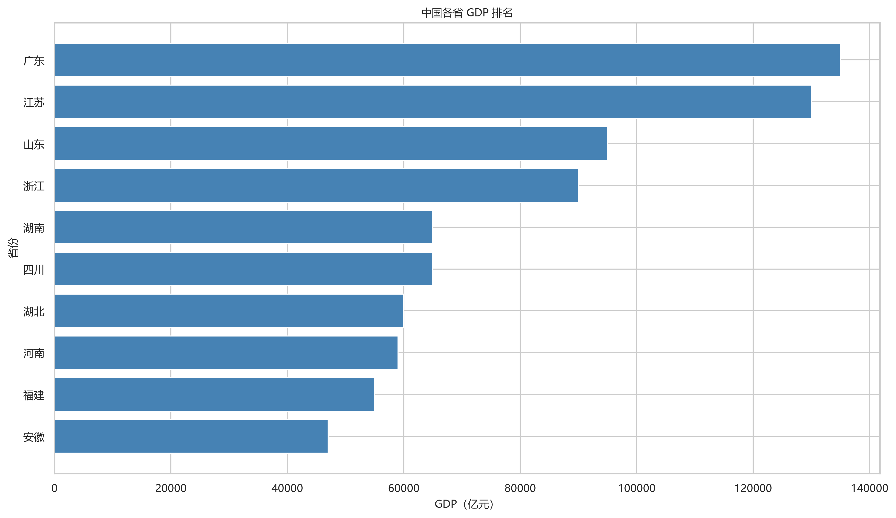
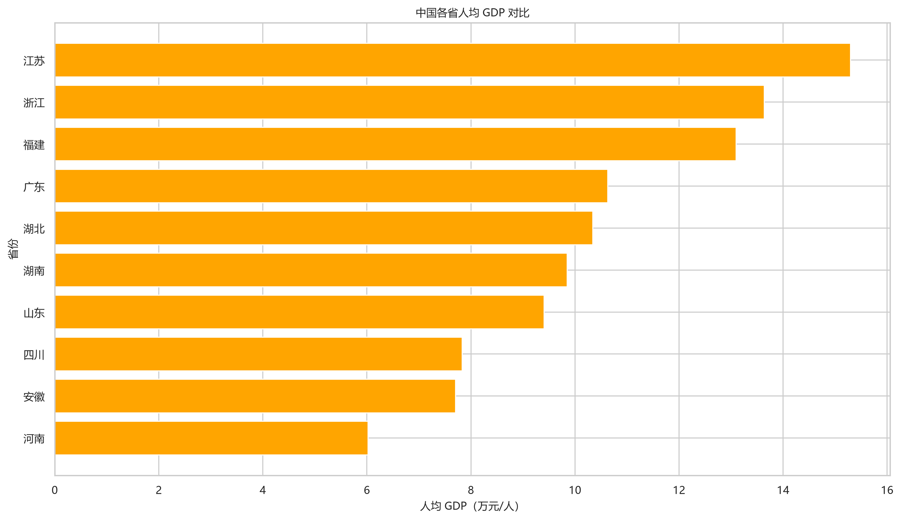
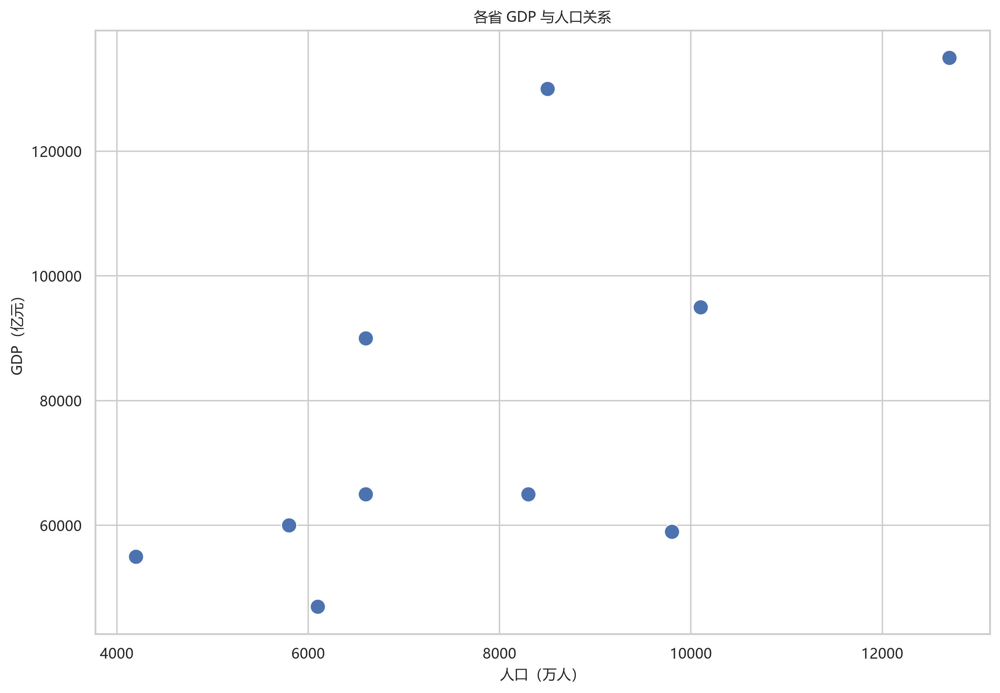

# 中国各省 GDP 数据分析（China GDP Analysis）

> 基于 Python 的入门级数据分析项目

## 项目简介

本项目使用 Python 对中国部分省份的 GDP 与人口数据进行读取、清洗、统计分析和可视化。

通过 Pandas、NumPy、Matplotlib 和 Seaborn，完成数据预处理、GDP 排名、人均 GDP 计算、GDP 占比分析，并自动生成三张数据可视化图表和一份 Markdown 分析报告。

**项目主要功能：**

- CSV 数据读取与结构检查
- 缺失值与重复记录处理
- GDP 排名计算
- 人均 GDP 计算
- GDP 占比分析
- 数据可视化
- 自动生成 Markdown 分析报告

> **数据声明：** 本项目当前使用教学示例数据，不是官方统计数据。缺失的 GDP 使用中位数填补，并通过「GDP是否估算」字段进行标记。所有计算结果仅用于演示 Python 数据分析流程，不应作为真实 GDP、经济排名或宏观经济结论引用。

---

## 1. 你将学到什么

通过本项目，可以学习以下 Python 数据分析知识：

1. 使用 Pandas 读取 CSV 文件，掌握 `read_csv()`、`head()`、`info()`、`describe()` 等基本操作。
2. 检查数据缺失情况和重复记录。
3. 使用 `drop_duplicates()` 删除重复数据。
4. 使用 `fillna()` 和 `median()` 处理缺失值。
5. 使用 `pd.to_numeric()` 进行数据类型转换。
6. 使用 `rank()` 计算 GDP 排名。
7. 使用 Pandas 完成人均 GDP 和 GDP 占比计算。
8. 使用 Matplotlib 和 Seaborn 制作统计图表。
9. 配置 Windows 中文字体，解决图表中文显示问题。
10. 使用 Python 函数和模块化思想组织程序。
11. 使用 `main.py` 一键执行整个分析流程。
12. 自动生成 Markdown 数据分析报告。
13. 用 Streamlit + Plotly 把结果做成可交互的网页看板。

## 2. 项目结构

```text
China_GDP_Analysis/
│
├── data/
│   ├── raw/
│   │   └── china_gdp.csv
│   │
│   └── processed/
│       ├── cleaned_gdp.csv
│       └── gdp_analysis.csv
│
├── maps/
│   └── china_provinces.geojson       # 中国省级行政区边界（GCJ-02）
│
├── output/
│   ├── charts/
│   │   ├── gdp_ranking.png
│   │   ├── gdp_per_capita.png
│   │   └── gdp_population.png
│   │
│   └── reports/
│       └── GDP_analysis_report.md
│
├── _archive/
│   └── 学习过程中的历史代码
│
├── main.py
├── app.py                            # Streamlit 交互式看板
├── requirements.txt
├── .gitignore
└── README.md
```

**目录说明：**

| 文件或目录 | 作用 |
|---|---|
| data/raw/ | 保存原始 CSV 数据 |
| data/processed/ | 保存清洗和分析后的数据 |
| maps/ | 保存中国省级行政区 GeoJSON 边界文件 |
| output/charts/ | 保存数据可视化图表 |
| output/reports/ | 保存自动生成的分析报告 |
| _archive/ | 保存学习过程中产生的历史代码 |
| main.py | 项目主程序（清洗 → 分析 → 出图 → 报告） |
| app.py | Streamlit 交互式看板，读取 main.py 的分析结果 |
| requirements.txt | 项目依赖清单 |
| .gitignore | Git 文件忽略规则 |
| README.md | 项目说明文档 |

`.venv/` 是 Python 虚拟环境，`.idea/` 是 PyCharm 配置目录，通常不需要上传到 GitHub。

## 3. 快速开始（Windows / PyCharm）

### 3.1 环境要求

- Windows 操作系统
- Python 3.10+
- PyCharm（推荐）
- Git（可选，用于版本管理）

本项目已在 Python 3.12.10 环境中完成运行验证。

### 3.2 打开项目并配置解释器

在 PyCharm 中：

1. 选择 File → Open。
2. 打开 `China_GDP_Analysis` 项目根目录。
3. 进入 File → Settings → Project → Python Interpreter。
4. 选择项目虚拟环境中的 Python 解释器。

Windows 示例：

```text
C:\Users\你的用户名\PyCharmProjects\China_GDP_Analysis\.venv\Scripts\python.exe
```

如果虚拟环境不存在，可以在 PyCharm 中创建新的 Virtualenv。

### 3.3 安装依赖

打开 PyCharm 底部的 Terminal，执行：

```bash
python -m pip install -r requirements.txt
```

`requirements.txt` 内容：

```text
pandas
numpy
matplotlib
seaborn
streamlit
plotly
```

前四个是 `main.py` 用到的库；`streamlit` 和 `plotly` 供 `app.py` 的交互式看板使用（详见第 13 节）。

检查 Python 解释器：

```bash
python -c "import sys; print(sys.executable)"
```

确保输出路径指向项目的 `.venv` 环境。

### 3.4 准备数据

将符合要求的 CSV 文件放入：

```text
data/raw/china_gdp.csv
```

如果该文件不存在，程序会自动创建一份教学示例数据，方便首次运行。

### 3.5 运行项目

在 PyCharm 中右键 `main.py`，选择 Run 'main'。

也可以在 Terminal 中执行：

```bash
python main.py
```

程序将自动完成数据读取、清洗、分析、可视化和报告生成。

### 3.6 启动交互式看板（可选）

```bash
python -m streamlit run app.py
```

终端会打印 `Local URL: http://localhost:8501`，用浏览器打开即可；关闭时在 Terminal 按 `Ctrl + C`。详细说明见第 13 节。

## 4. 数据格式与单位

输入 CSV 必须包含以下三个字段：

| 字段 | 含义 | 单位 |
|---|---|---|
| 省份 | 省级地区名称 | 无 |
| GDP | 地区生产总值 | 亿元 |
| 人口 | 常住人口 | 万人 |

示例数据：

```csv
省份,GDP,人口
广东,135000,12700
江苏,130000,8500
湖北,60000,5800
四川,65000,8300
浙江,90000,6600
```

建议使用 UTF-8-SIG 编码，减少 Excel 中文乱码问题。

### 人均 GDP 单位换算

程序中的计算公式：

```python
df["人均GDP"] = df["GDP"] / df["人口"]
```

因为：

- GDP 单位是亿元，即 10⁸ 元；
- 人口单位是万人，即 10⁴ 人。

所以：

$$
\frac{10^8\ \text{元}}{10^4\ \text{人}} = 10^4\ \text{元/人}
$$

最终结果单位为**万元/人**。例如广东：

$$
135000 \div 12700 \approx 10.63
$$

即约 10.63 万元/人。

注意：人均 GDP 不等于居民平均工资或居民实际收入。

## 5. 程序结构与数据传递

`main.py` 采用「一个主流程 + 七个函数」的结构，数据在函数之间按固定顺序传递。

### 5.1 数据流

```text
data/raw/china_gdp.csv
        │
        │  load_data()          读取 + 结构检查
        ▼
     df_raw ────────────────────────────────► (只打印，不修改)
        │
        │  clean_data(df_raw)   去重 / 补缺失 / 加标记列
        ▼
    clean_df ───────────────────────────────► data/processed/cleaned_gdp.csv
        │
        │  analyze_data(clean_df)   排名 / 人均 / 占比 / 排序
        ▼
  analysis_df  +  statistics(字典) ─────────► data/processed/gdp_analysis.csv
        │                    │
        │                    └──────────► generate_report(analysis_df, statistics)
        │                                              ▼
        └──► create_charts(analysis_df, font) ──► output/charts/*.png
                                                       │
                                                       ▼
                                          output/reports/GDP_analysis_report.md
```

三个关键点：

1. **每一阶段都返回新对象**，不在函数内部偷偷改上游数据（`clean_data` 内部先 `copy()`）。
2. **`clean_df` 和 `analysis_df` 是两个不同的 DataFrame**：前者只有清洗后的三列 + 标记列，后者多了排名、人均、占比三列并已排序。
3. **`statistics` 是一个普通字典**，只装 5 个标量（总量、均值、最大、最小、平均人均），图表和报告各取所需，避免重复计算。

### 5.2 函数签名与参数

| 函数 | 参数 | 返回 | 作用 |
|---|---|---|---|
| `setup_chinese_font()` | 无 | `FontProperties` | 依次尝试微软雅黑 / 黑体 / 宋体，返回第一个可用的中文字体，供画图使用 |
| `create_sample_data()` | 无 | `None` | 若 `china_gdp.csv` 不存在，则写入一份教学数据（含 1 条重复、1 个缺失 GDP） |
| `load_data()` | 无 | `DataFrame` | 读取 CSV，打印原始数据、`info()`、`describe()`、`shape`，**不改数据** |
| `clean_data(df)` | `df`：原始 DataFrame（省份/GDP/人口） | 清洗后的 `DataFrame` | 校验字段 → 类型转换 → 去重 → 同省多记录检查 → 标记估算 → 中位数填补 → 删人口缺失 → 写入 `cleaned_gdp.csv` |
| `analyze_data(df)` | `df`：已清洗的 DataFrame | `(DataFrame, dict)` | 新增 `GDP排名`、`人均GDP`、`GDP占比` 三列并排序，写入 `gdp_analysis.csv`，同时返回 `statistics` 字典 |
| `create_charts(df, font)` | `df`：已分析的 DataFrame；`font`：中文字体对象 | `None` | 绘制并保存三张图到 `output/charts/`；`font` 用于让标题、坐标轴显示中文 |
| `generate_report(df, statistics)` | `df`：已分析且已排序的 DataFrame；`statistics`：上一步的字典 | `None` | 生成 Markdown 报告，含关键指标、排名结论和三张图的相对链接 |
| `main()` | 无 | `None` | 按顺序调用以上函数，统一异常处理，最后打印结果保存位置 |

### 5.3 五阶段对照

| 阶段 | 函数 | 主要功能 |
|---|---|---|
| 第一阶段 | `load_data()` | 读取数据、检查数据结构 |
| 第二阶段 | `clean_data(df)` | 数据清洗与保存 |
| 第三阶段 | `analyze_data(df)` | 计算排名、人均 GDP 和占比 |
| 第四阶段 | `create_charts(df, font)` | 生成三张可视化图表 |
| 第五阶段 | `generate_report(df, statistics)` | 生成 Markdown 分析报告 |

程序通过 `main.py` 实现一键运行。

## 6. 数据清洗规则

数据清洗主要包括以下步骤：

### 6.1 检查缺失值

```python
print(df.isnull().sum())
```

统计每一列的缺失数据数量。

### 6.2 检查重复记录

```python
print(df[df.duplicated()])
```

找出完全重复的记录。

### 6.3 删除重复记录

```python
df = df.drop_duplicates()
```

保留唯一记录，避免重复数据影响后续统计。

### 6.4 检查同一省份的多条记录

```python
dup_prov = df[
    df.duplicated(subset=["省份"], keep=False)
]

if not dup_prov.empty:
    raise ValueError(
        "发现同一省份存在多条不同记录，请先核对数据。"
    )
```

如果同一省份存在多条不同数据，程序不会擅自合并，而是要求人工核对。

### 6.5 标记 GDP 缺失记录

```python
df["GDP是否估算"] = df["GDP"].isna()
```

在填补之前记录哪些数据属于估算数据。

### 6.6 使用中位数填补 GDP

```python
df["GDP"] = df["GDP"].fillna(
    df["GDP"].median()
)
```

中位数相对于均值受极端数值影响较小，适合用于演示缺失值填补方法。

但是，中位数填补不代表官方统计数据的补报方法。

### 6.7 删除人口缺失记录

```python
df = df.dropna(subset=["人口"])
```

人口缺失时无法计算人均 GDP，因此删除相应记录。

其他数据类型转换、无效数值处理及字段检查也在清洗函数中完成。

## 7. 指标计算

### 7.1 GDP 排名

```python
df["GDP排名"] = df["GDP"].rank(
    ascending=False,
    method="min"
).astype(int)
```

`ascending=False` 表示按照 GDP 从大到小排名。

`method="min"` 表示相同数值采用最小排名。

例如：

| 省份 | GDP | 排名 |
|---|---:|---:|
| 广东 | 135000 | 1 |
| 江苏 | 130000 | 2 |
| 四川 | 65000 | 5 |
| 湖南 | 65000 | 5 |
| 湖北 | 60000 | 7 |

### 7.2 人均 GDP

```python
df["人均GDP"] = df["GDP"] / df["人口"]
```

计算结果单位为万元/人。

### 7.3 GDP 占比

```python
df["GDP占比"] = (
    df["GDP"] / df["GDP"].sum() * 100
)
```

计算某省 GDP 占当前样本 GDP 总量的比例。

注意：如果输入数据不包含全部省级地区，这个比例不代表全国 GDP 占比。

## 8. 图表展示

运行一次 `main.py`，三张图会生成在 `output/charts/`。下面就是本项目当前数据跑出来的真实结果。

### 8.1 各省 GDP 总量排名



**怎么读：** 横向柱状图，从下往上是 GDP 由小到大，最上面一条是第一名。柱子的长度差就是总量差——广东（135000）接近安徽（47000）的 3 倍。

### 8.2 各省人均 GDP 对比



**怎么读：** 单位是万元/人。把这张图和 8.1 放在一起看，能直接看出「总量第一 ≠ 人均第一」：广东总量第一，人均约 10.63 万元排第三；江苏总量第二，人均约 15.29 万元却是第一。差别只在分母——人口。

### 8.3 GDP 与人口关系



**怎么读：** 横轴人口（万人）、纵轴 GDP（亿元），每个点是一个省。越靠右表示人口越多，越靠上表示 GDP 越高；点到原点连线的斜率大致就是该省的人均 GDP。

> 图表由当前输入数据生成，重新运行 `main.py` 会覆盖。正式研究时应替换为可靠的官方统计数据。

## 9. 输出文件

成功运行一次 `main.py` 后，程序会生成以下文件：

| 文件 | 内容 |
|---|---|
| `data/processed/cleaned_gdp.csv` | 清洗后的数据，包含估算标记 |
| `data/processed/gdp_analysis.csv` | GDP 排名、人均 GDP、GDP 占比 |
| `output/charts/gdp_ranking.png` | GDP 排名柱状图 |
| `output/charts/gdp_per_capita.png` | 人均 GDP 对比图 |
| `output/charts/gdp_population.png` | GDP 与人口关系散点图 |
| `output/reports/GDP_analysis_report.md` | 自动生成的 Markdown 分析报告 |

报告中的图表使用相对路径引用，例如：

```markdown

```

## 10. 一次实际运行的结果

使用项目内的教学示例数据运行：

- 原始数据：11 行。
- 清洗后数据：10 行。
- 删除重复记录：1 条。
- GDP 缺失记录：1 条。
- 湖南 GDP 使用中位数 65000 填补。
- GDP 总量：801000 亿元。
- 平均 GDP：80100 亿元。
- GDP 最高值：135000 亿元。
- GDP 最低值：47000 亿元。
- GDP 排名第一：广东。
- 人均 GDP 最高：江苏，约 15.29 万元/人。

由于湖南填补后的 GDP 恰好与四川相同，因此两省并列第五，下一名为第七。

这些结果仅用于展示程序运行情况，不代表真实经济统计结论。

## 11. 数据说明与项目局限性

本项目目前属于 Python 数据分析教学项目，存在以下限制：

1. 数据为教学示例数据，并非官方统计数据。
2. GDP 缺失值使用中位数填补，可能影响排名和统计结果。
3. 样本省份数量有限，不能代表全国经济情况。
4. 人均 GDP 不能替代居民收入、生活成本或发展质量等指标。
5. GDP 与人口之间的关系不能仅凭散点图推断因果关系。
6. 不同年份、不同统计口径的数据不能直接混合比较。

未来使用真实统计数据时，应注明：

- 数据来源；
- 统计年份；
- 发布日期；
- 数据单位；
- 人口统计口径；
- GDP 核算口径；
- 缺失值处理方法。

## 12. 发布到 GitHub

### 12.1 初始化仓库

在项目根目录打开 Terminal：

```bash
git init
```

### 12.2 添加文件

```bash
git add -A
```

### 12.3 提交代码

```bash
git commit -m "init: 中国各省 GDP 数据分析（教学项目）"
```

### 12.4 关联 GitHub 仓库

```bash
git remote add origin https://github.com/<你的用户名>/China_GDP_Analysis.git
```

### 12.5 推送代码

```bash
git branch -M main
git push -u origin main
```

### 12.6 文件管理建议

`.gitignore` 建议排除：

- `.venv/`
- `.idea/`
- `__pycache__/`
- `*.pyc`
- 本地临时文件。

保留项目源码、README、依赖文件、原始教学数据，以及需要展示的图表（见 12.7 节）。

### 12.7 图片如何显示在 GitHub 上

README 里的图片要能在 GitHub 上显示，必须同时满足三个条件，缺一不可：

1. **路径是仓库内的相对路径**（本项目用 `output/charts/xxx.png`）；
2. **图片文件真的被提交进了仓库**；
3. **提交时的分支与 README 所在分支一致**（都是 `main`）。

最容易出问题的就是第 2 条：**本地图片正常，线上却是裂图**。原因几乎都是 `.gitignore` 把 `output/` 整个忽略了——文件在本机存在，但从未进入 Git。

本项目采用的规则是「默认忽略运行产物，只白名单三张需要展示的图」：

```gitignore
output/charts/*
!output/charts/.gitkeep
!output/charts/gdp_ranking.png
!output/charts/gdp_per_capita.png
!output/charts/gdp_population.png
```

这样既不会被一堆临时图污染仓库，又能保证 README 里的三张图始终可用。

#### 自查三步

```bash
# 1) 图片是否已进入版本库（应列出三张 png）
git ls-files output/charts

# 2) 是否被 .gitignore 拦住（应无输出，说明未被忽略）
git check-ignore -v output/charts/gdp_ranking.png

# 3) 已推到远端后，检查原始文件能否访问
# 浏览器打开：https://raw.githubusercontent.com/<用户名>/<仓库>/main/output/charts/gdp_ranking.png
```

如果第 1 步没列出图片，但本地确实有文件，就执行：

```bash
git add -f output/charts/gdp_ranking.png
git add -f output/charts/gdp_per_capita.png
git add -f output/charts/gdp_population.png
git commit -m "docs: 加入图表，供 README 展示"
git push
```

> 提示：`git add -f` 可以绕过忽略规则强制加入，但之后每次重新生成图表都要再 `git add` 一次。长期做法还是像本项目一样在 `.gitignore` 里加白名单。

## 13. 交互式数据分析网页

本项目使用 Streamlit 和 Plotly 开发了交互式 GDP 数据分析平台。

### 功能

- 各省 GDP 排名查询（按 GDP 从高到低，最大值固定显示在顶部）
- 人均 GDP 对比
- 四大区域（东部 / 中部 / 西部 / 东北）GDP 汇总对比
- GDP 占比分析
- 省份、区域多选筛选
- GDP 排名前 10 快速筛选
- 中国各省 GDP 地理分布地图（颜色深浅表示 GDP 高低）
- GDP 与人口关系分析
- 图例区分「原始数据 / 估算数据」，可一键排除估算值
- 分析数据 CSV 下载

### 安装依赖

```bash
pip install -r requirements.txt
```

### 启动网页

```bash
python -m streamlit run app.py
```

### 本地访问

http://localhost:8501

注意：网页读取 `data/processed/gdp_analysis.csv`，运行网页之前需要先运行 `main.py`。

区域划分采用国家统计局四大区域口径（东部 10 省、中部 6 省、西部 12 省、东北 3 省）；当前教学数据只覆盖 10 个省份，因此页面上的区域汇总只包含有数据的区域。

### 中国各省 GDP 交互式地图

本项目使用 Plotly + GeoJSON 实现中国省级 GDP 地图。

地图功能：

- 省级行政区边界展示（灰色底图，保证轮廓完整）
- 有数据的省份按 GDP 深浅着色，悬停可看 GDP、人均 GDP、排名、数据状态
- 与左侧省份 / 区域 / GDP 区间筛选联动
- 无数据省份保持灰色，**不会被误读为 GDP 为零**

**地图数据来源**

| 项目 | 内容 |
| --- | --- |
| 文件 | `maps/china_provinces.geojson`（约 582 KB） |
| 来源 | 阿里云 DataV.GeoAtlas：`https://geo.datav.aliyun.com/areas_v3/bound/100000_full.json` |
| 下载日期 | 2026-11-02 |
| 内容 | 34 个省级行政区边界（含港澳台） |
| 坐标系 | GCJ-02（高德坐标系） |
| 用途限制 | 仅用于省级区域着色展示，**不作为精确测绘、导航或边界认定依据** |

> 地图边界与 GDP 数据是两类独立数据：GDP 来自本项目 `main.py` 生成的教学示例数据，边界来自上述公开数据源，二者不互相校验。

启动后终端会打印 `Local URL`，用浏览器打开即可；关闭时在 Terminal 按 `Ctrl + C`。

```text
main.py  →  data/processed/gdp_analysis.csv  →  app.py（只读，不写文件）
```

## 14. 下一步改进方向

本项目可以继续从以下方面升级：

1. **真实数据接入：** 使用国家统计局或各省统计年鉴中的公开数据。
2. **跨年度分析：** 增加年份字段，分析各省 GDP 变化趋势。
3. **区域分析：** 使用 `groupby()` 对东部、中部、西部和东北地区进行分组统计。
4. **数据可视化升级：** 增加 GDP 增长率、区域对比和交互式图表。
5. **程序模块化：** 将清洗、分析和可视化拆分为独立 Python 模块。
6. **自动化测试：** 为核心计算函数编写测试。
7. **命令行参数：** 支持自定义输入文件和输出目录。
8. **交互式仪表盘：** 使用 Streamlit + Plotly 开发数据展示页面（依赖已在 `requirements.txt` 中，页面待开发）。

---

---

## 15. 3.2：地图点击联动

3.2 在原有省份、区域、GDP 区间、估算数据和 GDP TOP10 筛选之上，增加了地图点击选择。

- 单击地图中有数据的省份，会同步更新左侧“选择省份”。
- KPI 指标卡、GDP/人均 GDP 图、区域汇总、散点图、饼图、明细表和 CSV 下载都使用同一份筛选结果。
- “清除地图选择（恢复原省份筛选）”只还原点击前的省份集合，不会改动区域、GDP 区间、TOP10 或估算数据开关。
- 地图的 GDP 蓝色色标固定取完整教学样本的最小/最大值，所以筛选前后相同 GDP 的颜色含义一致。
- 估算数据沿用橙色边框；当前候选集中没有数据的地图边界显示灰色；选中省份以深色边框强调。

### 地图实现

地图显示层将 GeoJSON 的 Polygon 和 MultiPolygon 外环转换为独立 SVG path。一个省份即使有多个离散岛屿，也会被拆成多个 shape，避免多段 Scatter 填充时可能出现的错误连接。

Plotly 的 layout shape 本身不会向 Streamlit 发送选择事件，因此页面在它上方放置了透明的 Polygon 命中层和透明中心点。它们只承担点击与悬停，不参与着色。选择结果写入 Streamlit session_state 后，在下一次受控刷新开始前更新 multiselect；同一选择不会重复刷新，因此不会出现 rerun 循环。

### 依赖版本

本版本使用 Streamlit 的原生 Plotly 选择事件，需要 Streamlit 1.35 或更新版本。requirements.txt 已指定 streamlit>=1.35.0。若运行环境更旧，页面会保留地图和其他所有分析功能，并显示升级提示，而不会报错。

### 运行

1. 安装依赖：python -m pip install -r requirements.txt
2. 生成分析数据：python main.py
3. 启动页面：python -m streamlit run app.py

详细验收清单见 VALIDATION_NOTES.md。

---

## 附录：学习过程中的历史代码

`_archive/` 文件夹用于保存学习过程中的中间脚本，不参与当前主程序运行。

其中部分旧脚本仍然使用历史文件名 `data/raw/gdp_data.csv`，而当前项目统一使用：

```text
data/raw/china_gdp.csv
```

因此，旧脚本直接运行时可能出现 `FileNotFoundError`。

保留这些文件的主要目的是记录项目从基础 Python 练习逐步发展为完整数据分析项目的过程。

如果不需要保存学习记录，可以删除整个 `_archive/` 文件夹，不影响 `main.py` 的正常运行。

---

**项目名称：** China GDP Analysis

**项目类型：** Python 数据分析教学项目

**主要技术：** Python、Pandas、NumPy、Matplotlib、Seaborn

**项目目标：** 学习数据读取、清洗、统计分析、可视化和自动化报告生成。

---
